# Tehreer-ReactNative

React Native wrapper of [Tehreer Core](https://github.com/Tehreer/Tehreer-Core), a lightweight, dependency-free text engine written in C89. It exposes the public Core API to React Native through one C++ JSI layer shared by iOS and Android, with a TypeScript API shaped like Tehreer-Web, Tehreer-Android and Tehreer-Cocoa.

The package has the whole public Core API in TypeScript (`src/`), the two views `TLabel` and `TTextView` (with the thin native `TLinePaint` view that draws lines), a test-runner app (`example/`) and a demo app (`demo/`).

## Constraints

- New architecture only: Fabric, C++ TurboModule, Hermes. No old bridge.
- No Skia.
- No WebAssembly.
- Core owns all text logic; the wrapper is a thin bridge and never re-implements layout, shaping or matching.
- No runtime dependency. `react` and `react-native` are peer dependencies.

## Development

Requires Node 22.18 or newer (tests run TypeScript directly) and npm.

```bash
npm install
npm run typecheck   # strict tsc over src and tests
npm run lint        # ESLint (flat config)
npm test            # node:test suites in tests/
npm run build       # emit dist/ (JavaScript and declarations) from src/
```

`.npmrc` sets `legacy-peer-deps`: `react` and `react-native` are peer dependencies with the range `*`, and the pinned copies in `devDependencies` are the ones the type checks and the apps use, so npm must not resolve or install a second copy for the peers.

## Core and its dependencies

Tehreer Core is the git submodule `Libraries/TehreerCore`, pinned to a SHA. After `git clone --recurse-submodules` (or on a clone without submodules), one command gets Core and the sources of FreeType, HarfBuzz, SheenBidi and libunibreak:

```bash
scripts/fetch-deps   # or: npm run setup
```

The dependency versions are read from Core's `CMakeLists.txt` at run time, so they always match what Core pins. Sources land in the git-ignored `Libraries/Dependencies`, laid out for Core's `TR_DEPS_DIR`. Re-running is a no-op unless a pin changed.

To move Core to another commit (this fetches, checks out and stages the pointer):

```bash
scripts/sync-core <sha|ref>
scripts/sync-core main /Users/mta/Learning/Tehreer-Core   # fetch from a local Core instead of origin
```

## Android

Supported ABIs: `armeabi-v7a`, `arm64-v8a`, `x86` and `x86_64`. The minimum SDK is 24 and the NDK is 28.2.13676358 (the version the example app pins in `example/android/build.gradle`; it is the only NDK that is tested). The module is built with CMake as part of the app's native project, together with Core and its dependencies, and needs `scripts/fetch-deps` to have run first.

The ABIs are not chosen by this library: the app picks them with the `reactNativeArchitectures` property, in `gradle.properties` or on the command line, and React Native builds only those.

```bash
./gradlew assembleDebug -PreactNativeArchitectures=arm64-v8a,x86_64
```

The wrapper sources are compiled with `-Wall -Wextra` and must stay free of warnings; `android/CMakeLists.txt` picks up new files in `cpp/`, `cpp/runtime/` and `cpp/generated/` by itself.

`npm run test:android` builds the example app for the connected emulator, starts Metro, launches the app and runs every suite registered in `example/tests/index.ts` (output format in [AGENTS.md](AGENTS.md#device-test-output)). It exits non-zero on a failing test, a timeout or a missing result line. `npm run test:android -- --release` does the same with the release build (`assembleRelease`, signed with the debug key of the example app, and no Metro: the bundle is inside the app), which is the build where `FontFile.fromAsset` reads a copy of a `res/raw` resource.

### Native memory of `TLabel` and `TTextView` on Android

Measured on an API 30 arm64 emulator (debug build, `dumpsys meminfo` Native Heap "Heap Alloc", 800 mounts and unmounts of a one-line label, 20 at a time, before and after a Hermes collection). Mounting costs more native memory than a React Native `Text`, and part of it stays:

| What is mounted (800 times) | Before a collection | After it, still allocated |
|---|---|---|
| `Text` | about 3 KB each | none |
| plain `View` with a background | about 17 KB each | none |
| `TLabel` | about 20 KB each | about 8 to 9 KB each |
| `TTextView` | about 14 KB each | not measured separately |
| an empty `TLinePaint` (no frame, no typesetter) | about 8 KB each | about 4.5 KB each |
| `Typesetter` + `FrameResolver` + frame + registration, without a view (JavaScript only) | none | none |
| a Core `Renderer` made and disposed from JavaScript | none | none |

About 11 KB of a label's growth is native memory that waits for a collection (the glyph bitmaps of the draw, Java and Hermes objects) and is given back by it. What stays after a collection is linear in the number of mounts, so it is not a cache that levels off; Core objects, the id tables and the registrations do not contribute (the rows without a view), and the empty `TLinePaint` already keeps about half of it. The allocation site inside the native view or Fabric was not identified: `heapprofd` cannot be used on this emulator (the client disconnects during start-up when the ring buffer fills, and attaching to a running app crashed it), and malloc debug cannot be switched on for a debuggable app on a user build. The numbers are a bound, not a verdict: use a build with symbols and `heapprofd` on a device that allows it to find the site.

## iOS

Supported architectures: `arm64` for devices and `arm64` and `x86_64` for the simulator. The deployment target is the one React Native 0.88 supports (iOS 15.1). Core and its dependencies are compiled from source into the pod by `tehreer-react-native.podspec`, together with the wrapper sources in `cpp/` (all subfolders) and `ios/`: the C files are compiled as C (Core as C89, FreeType, SheenBidi and libunibreak as gnu99), `harfbuzz.cc` and the wrapper as C++20. New files in `cpp/` and `ios/` are picked up by the next `pod install`.

```bash
npm run setup                                  # fetches the dependency sources, once
cd example/ios && LANG=en_US.UTF-8 pod install  # CocoaPods needs a UTF-8 locale
xcodebuild -workspace TehreerExample.xcworkspace -scheme TehreerExample -sdk iphonesimulator \
  -destination 'generic/platform=iOS Simulator' ARCHS="arm64 x86_64" ONLY_ACTIVE_ARCH=NO build
```

Use `-sdk iphoneos -destination 'generic/platform=iOS' ARCHS=arm64` for a device build. The wrapper sources must stay free of compiler warnings; warnings from Core and the dependencies are reported by Xcode too and are not fixed here.

`npm run test:ios` builds the example app for the booted simulator, starts Metro, launches the app and runs every suite registered in `example/tests/index.ts` and prints a per-suite summary and the names of failing tests. It exits non-zero on a failing test, a timeout or a missing result line. `npm run test:ios -- --release` does the same with the Release configuration, which bundles the JavaScript into the app and starts no Metro.

## Demo

`demo/` is a React Native app of its own (`TehreerDemo`, separate from the test runner in `example/`): the screens of the Tehreer-Web demo on `TLabel` and `TTextView`, written against the public API only (`import ... from 'tehreer-react-native'`, no internal imports) and without a navigation library. It links the library from the repository root, like `example/`, and runs it from its TypeScript sources.

```bash
cd demo && npm install
cd ios && LANG=en_US.UTF-8 pod install && cd ..   # iOS only
npm start                                          # Metro
npm run ios                                        # or: npm run android
```

The code follows the usual React Native layout: `demo/src/App.tsx` (navigation state and transitions), `components/` (one file per component), `screens/` (one file per screen), `hooks/`, `theme/`, `utils/`, `data/` and `fonts/` (the font list and loader).

| Screen | What it shows |
|--------|---------------|
| Bidirectional Algorithm | Embedding levels, logical runs and visual order of mixed-direction text (`BidiAlgorithm`) |
| Typeface Information | Names and metrics of a typeface, and a specimen in a `TLabel` |
| Typeface Glyphs | Every glyph ID of a typeface, each drawn from its ID, a "Go to glyph ID" field, and a Glyph Info screen with the outline, metrics and previous/next buttons |
| OpenType Shaping | Script and language tags, clusters, glyph IDs, offsets and advances (`ShapingEngine`) |
| Variable Fonts | Instances, color palettes and axes of a variable font (`getVariationInstance`, `getColorInstance`) |
| Custom Label | A `TLabel` of styled Urdu text with tappable links |
| Custom Text View | A `TTextView` of colored Arabic text with justification, verse selection and an adjustable size |

The fonts are in `demo/assets/fonts` (see the README there). The default text typeface is AlQalam Taj Nastaleeq. The Unicode value of a glyph is found by scanning only the Basic Multilingual Plane (up to U+FFFF), so a glyph that only a supplementary-plane code point reaches has none. The glyph screens draw any glyph by its ID with the public `Renderer` only: `getGlyphImage` / `getStrokeImage` give the pixels, which the demo wraps in a PNG (`demo/src/utils/glyphBitmap.ts`) and shows with an `Image`, so no dependency or native code is needed.

iPhone 16 Pro simulator:

| | |
|---|---|
| 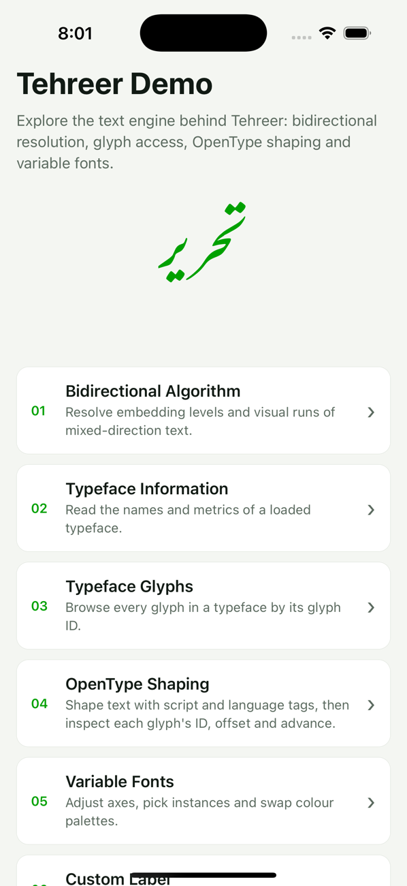 | 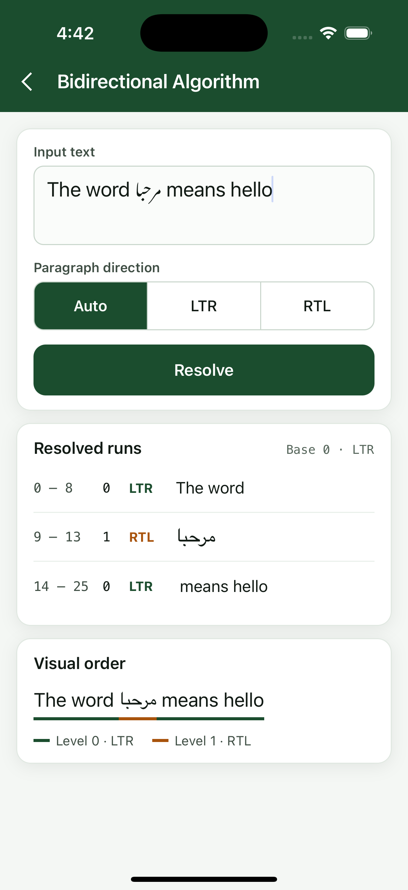 |
| 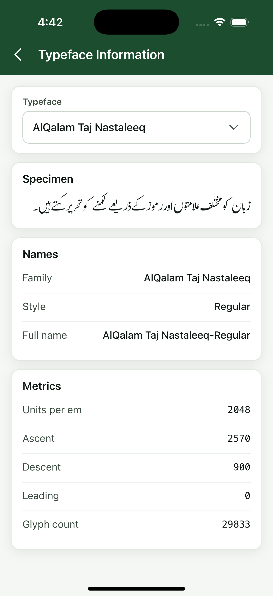 | 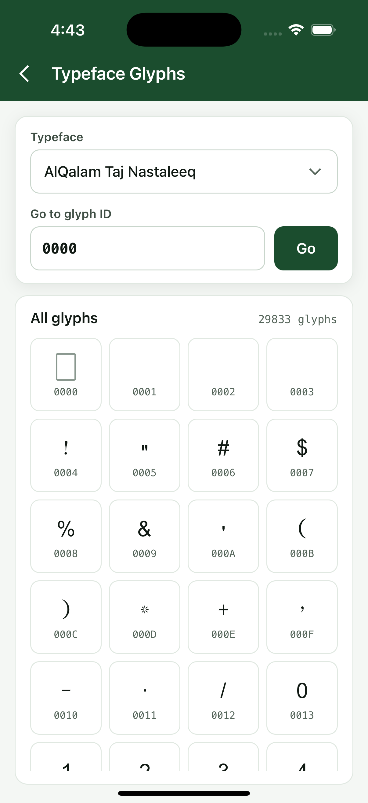 |
| 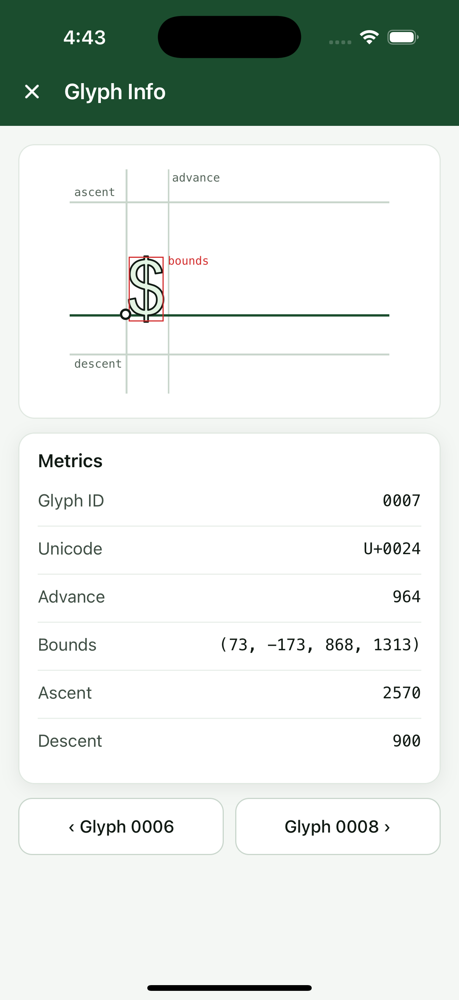 | 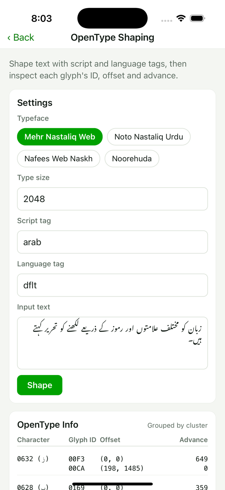 |
| 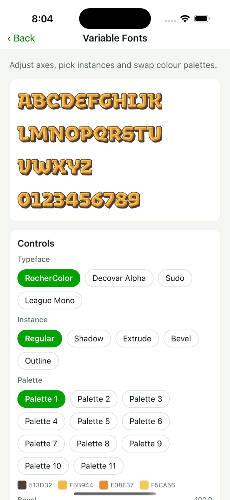 | 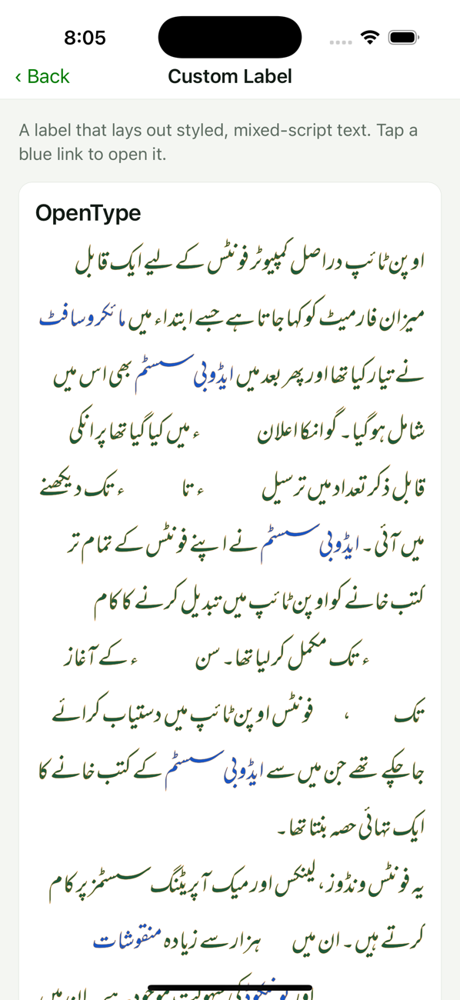 |
| 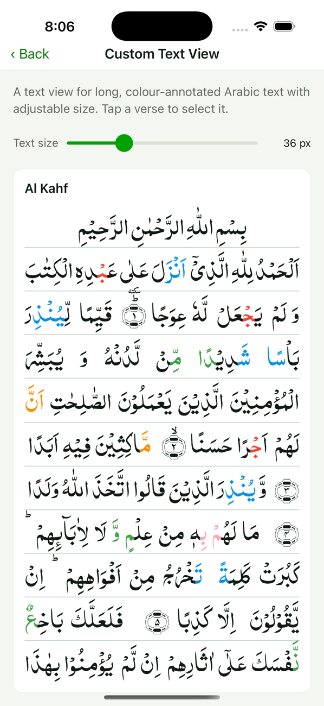 | |

Android emulator (Pixel-sized, API 28, arm64):

| | | |
|---|---|---|
| 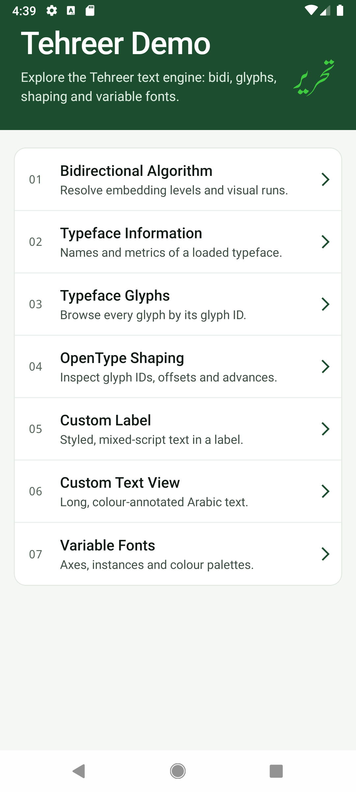 | 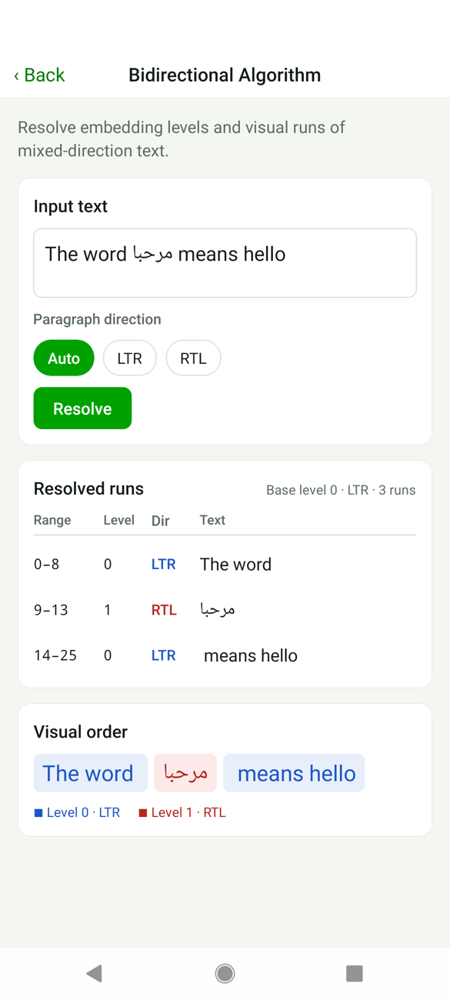 | 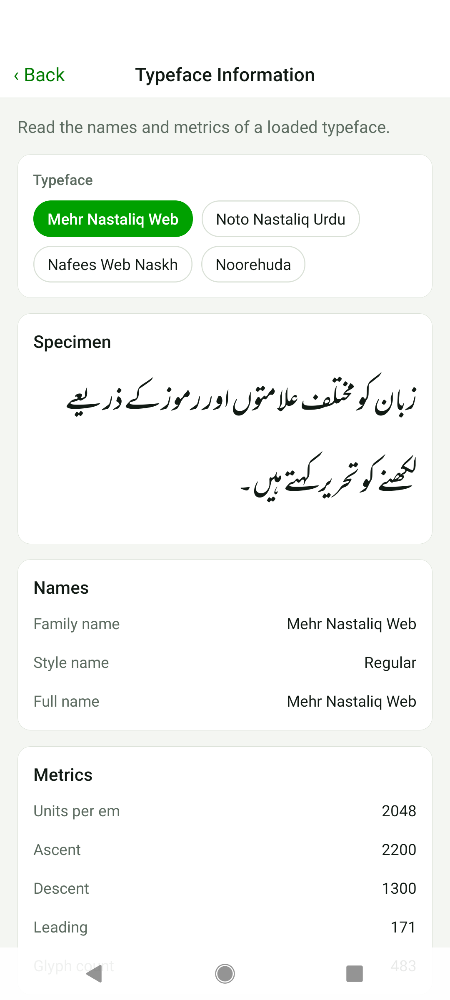 |
| 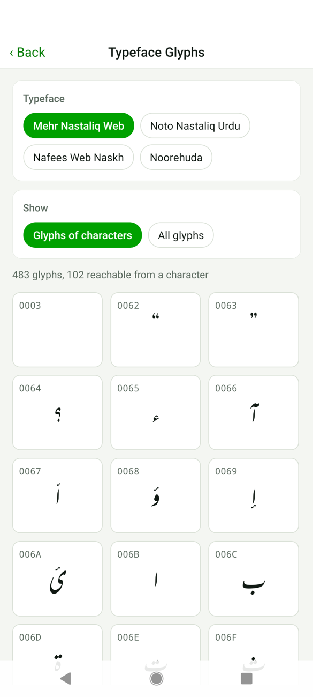 | 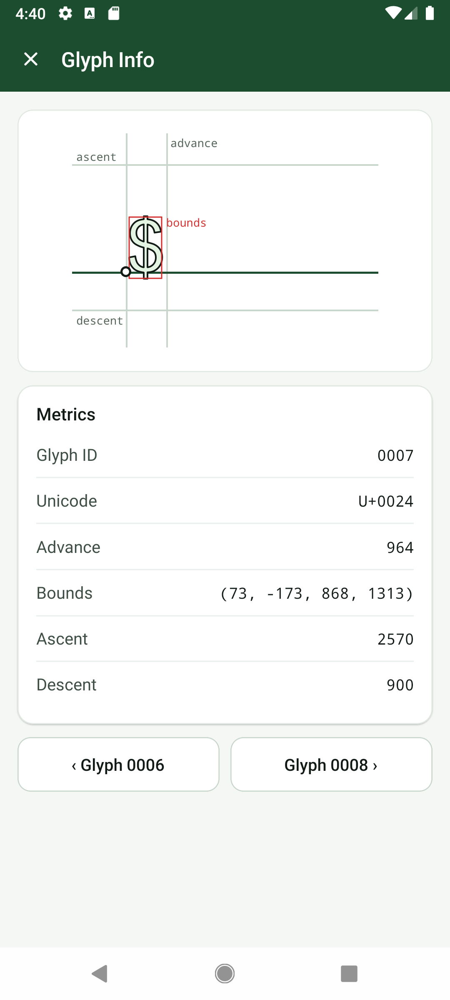 | 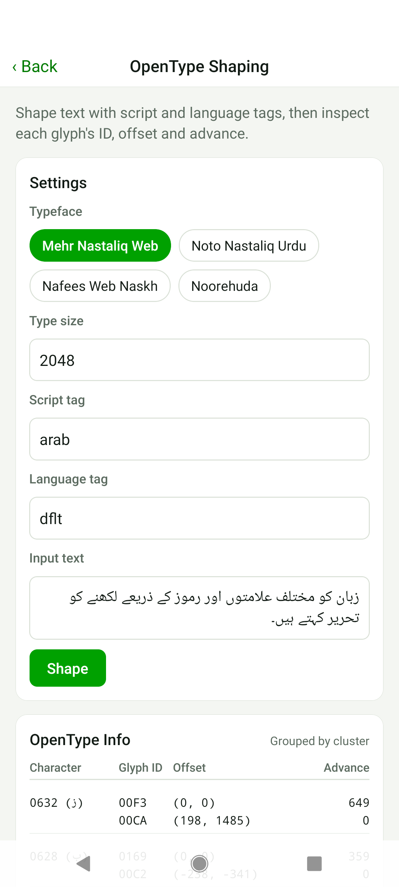 |
| 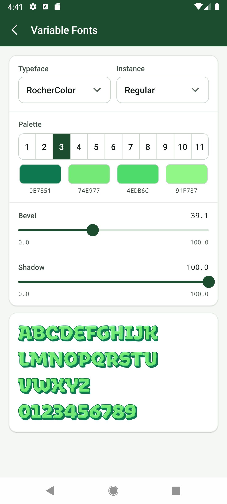 |  | 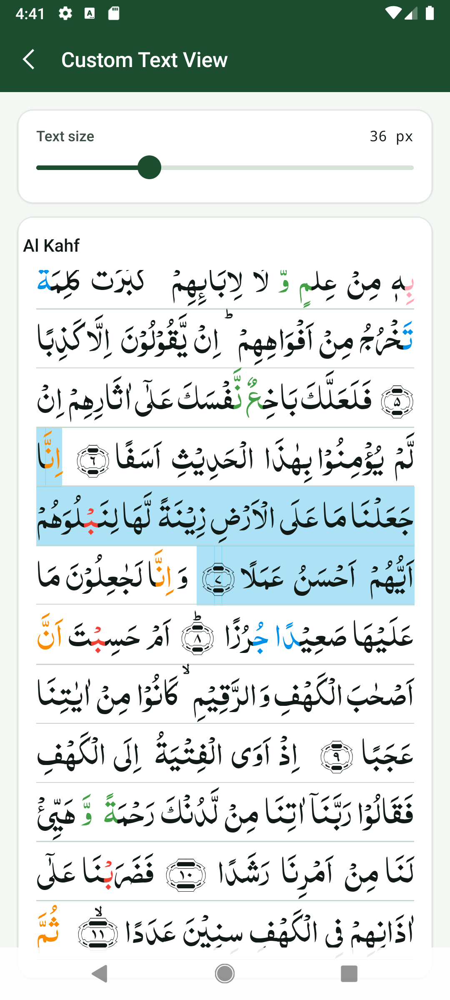 |

## Packaging

The npm package contains the source of Tehreer Core and of its dependencies (FreeType, HarfBuzz, libunibreak, SheenBidi), so `pod install` and the Gradle build compile everything locally and nothing is downloaded at install or build time. The `prepack` script copies them from `Libraries/` (run `git submodule update --init` and `npm run setup` first; `npm pack` fails with a message if either is missing). Only sources, headers, the CMake files the builds read and the licence files are packed, about 3.3 MiB compressed. The licences of the bundled libraries are listed in `NOTICE`. `npm run test:packed` packs the library, installs the tarball into a scratch copy of the example app and builds it (Android with Gradle, iOS with `pod install`).

## Loading fonts

A `FontFile` is made from bytes or from a file; Core copies the data it reads, so nothing has to stay alive afterwards. Pick the source that fits where the font lives. No option needs a package besides this one.

| Where the font is | Call | Notes |
|-------------------|------|-------|
| Bundled with the app (`require`) | `await FontFile.fromAsset(require('./Roboto.ttf'))` | Debug and release builds, see below. Asynchronous. |
| A file on the device | `FontFile.fromPath(path)` | Synchronous. The path is a plain file system path, not a `file:` URL. |
| Bytes in memory | `FontFile.fromBytes(bytes)` | `ArrayBuffer` or any typed array or `DataView`. Synchronous. |
| On a server | `FontFile.fromBytes(await (await fetch(url)).arrayBuffer())` | The library does not fetch; check `response.ok` yourself. |

```ts
import { FontFile, initialize } from 'tehreer-react-native';

initialize();
const file = await FontFile.fromAsset(require('./assets/Roboto-Regular.ttf'));
const typeface = file.typefaces.get(0); // a typeface keeps the font data after the file is disposed
file.dispose();
```

`fromAsset` accepts the number that `require()` returns, or an object with the `uri` of the asset. What it does depends on how React Native resolves the asset:

- **Debug build** (Metro serves the asset over http): it fetches the bytes and reads them with `fromBytes`.
- **Release build on iOS**: Metro copies the asset into the app bundle and the URI is a `file:` URL, so the file is read with `fromPath`.
- **Release build on Android**: Metro puts a font into `res/raw`, which is not a file. The library's small native module copies the resource into the cache directory of the app (`cache/tehreer-assets/<install time>/<name>`, once per install or update, on a background thread) and the copy is read with `fromPath`.

The font extension (`.ttf`, `.otf`, `.ttc`) has to be one of Metro's `assetExts`, which the default configuration of React Native includes. Call `initialize()` first (it also installs the asset reader). A missing or unreadable asset rejects with an `Error` that names the asset (`Could not load the font asset <uri>: <reason>`), and a value that is not a font asset is a `TypeError`. The `FontFile` that the promise resolves to is owned by the caller, like any other.

**Apps that prefer a file system package.** If the app already uses a library such as `react-native-fs` or `expo-file-system` (to download fonts at run time, say), save the font there and call `FontFile.fromPath(path)` with the path it gives; that needs no asset support from this library.

## Enums

The Core enums (`TypeWeight`, `StrokeCap`, `TextAlignment` and so on) are exported as constant objects with a type of the same name (`const X = { ... } as const; type X = ...`) instead of TypeScript `enum`s, because the project compiles with `erasableSyntaxOnly`. They are used the same way as Web's enums (`TypeWeight.Bold`, `value: TypeWeight`), but are not enum objects at run time. Web's `unicode` enums (bidi class, general category, script) come from SheenBidi's headers and are added by a separate issue.

## Continuous integration

Workflows live in `.github/workflows/`:

| File | Runs | Triggers | What it does |
|------|------|----------|--------------|
| `ci.yml` (job `checks`) | ubuntu, 15 min limit | every pull request, every push to `main` | `npm ci`, typecheck, lint, `npm run generate:check`, `npm test` with the spec reporter (every test name and its failure details appear in the log) |
| `device-tests.yml` (jobs `ios`, `android`) | macOS and ubuntu with KVM, 60 min limit | only the triggers below | fetches the Core dependencies (`scripts/fetch-deps`), then `npm run test:ios` on a booted simulator and `npm run test:android` on an API 34 x86_64 emulator (`reactivecircus/android-emulator-runner`) |
| `claude-review.yml` | ubuntu | pull requests | automated review; the only workflow with a secret |

Every checkout uses `submodules: recursive`, because the generator and the tests read Core's headers. None of `ci.yml` and `device-tests.yml` uses a secret, and both only request `contents: read`. A new push to a pull request cancels the older `checks` run.

**Why the device tests are separate.** The repository is private, so macOS minutes are billed at ten times the Linux rate, and an emulator on a Linux runner needs several minutes to boot and build. Running them on every push would cost more than they are worth during development. They start only

- by hand: Actions tab, "Device tests", "Run workflow", then pick `all`, `ios` or `android`;
- when the label `device-tests` is added to a pull request (`gh pr edit <number> --add-label device-tests`);
- on every later push to a pull request that carries the label. Remove the label to stop them.

Pull requests from forks never start the device jobs. Run the same tests locally with `npm run test:ios` and `npm run test:android` (see the platform sections above).

The actions are pinned to version tags, not commit SHAs: the repository has no secrets in these workflows and read-only permissions, which limits what a moved tag could do, and tags stay readable and are what `claude-review.yml` already uses. `tests/workflows.test.ts` enforces that every action carries a version tag. Pin SHAs if the workflows ever get a secret or write access.

**Not verified yet.** A workflow cannot run before it is pushed, and a `pull_request` workflow runs from the version on the pull request branch. At the time of writing neither workflow has run: the YAML parses and `tests/workflows.test.ts` checks its structure, but the first runs on GitHub may still reveal problems (the pinned `android-emulator-runner` version, the emulator image, runner disk space, the simulator boot step). Fix those in the first pull request that triggers them.

## Repository layout

See [AGENTS.md](AGENTS.md) for the layout, conventions and contribution workflow, and `.claude/skills/react-native-wrapper/SKILL.md` for the design rules.

## License

Apache 2.0, see [LICENSE](LICENSE) and [NOTICE](NOTICE).
